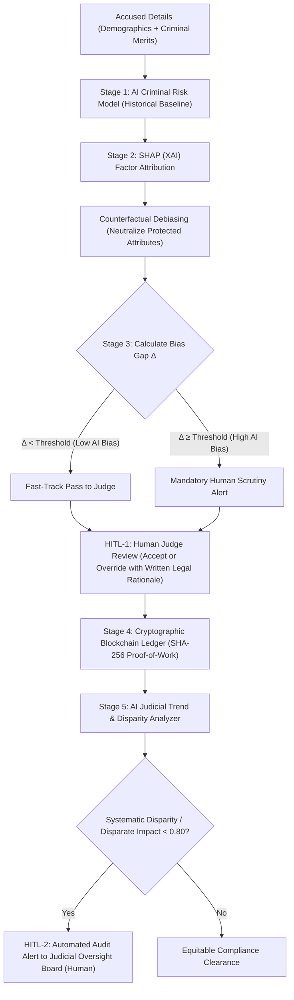

# AI Bias Mitigation in Legal Systems: A Dual-Level Human-in-the-Loop & Blockchain Architecture

An end-to-end prototype designed to prevent algorithmic and human bias in criminal justice risk
assessments, ensure judicial transparency through immutable blockchain records, and hold both
AI models and human judges accountable.

**Live app:** https://fairai-legal-system.streamlit.app/  
**Repo:** https://github.com/yogarisi745-star/fairai  
**License:** MIT  
**Prototype only — NOT for real court use.**

---

## System Architecture & Workflow

The framework operates in **6 sequential stages** with **two independent Human-in-the-Loop (HITL) checkpoints**:



---

## Key Components

### 1. AI Criminal Risk Scoring (`model.py`)
- OLS linear regression fitted on the real ProPublica COMPAS dataset (5,278 defendants).
- Distinguishes **legal merits** (prior offences, offense severity, age) from **protected attributes** (race, gender).
- Weights loaded from `compas_weights.json` (cached); refit from CSV if cache is absent.

### 2. SHAP (XAI) & Counterfactual Debiasing (`xai_shap.py`)
- **Shapley Values:** Exact marginal contribution φ_i of each feature relative to population baseline.
- **Counterfactual Debiasing:** Sets race → Caucasian, gender → Male, keeps criminal merits fixed.
- **Bias Gap Δ:** `|original_score − debiased_score|`; threshold 5.0 pts (COMPAS mode).

### 3. Judge Review — HITL-1 (`legal_system.py`)
- Human judge can Accept debiased recommendation or Override with mandatory written reasoning.
- High-bias cases (Δ ≥ 5.0) are flagged for mandatory scrutiny.

### 4. Cryptographic Blockchain Ledger (`blockchain.py`)
- SHA-256 proof-of-work chain records case ID, scores, SHAP summary, judge action, written reasoning.
- Any post-hoc tampering immediately invalidates the hash chain.

### 5 & 6. Judicial Oversight Board — HITL-2 (`judicial_monitor.py`)
- EEOC Four-Fifths Rule (Disparate Impact Ratio < 0.80) + Fisher's exact / χ² test.
- Requires minimum 20 cases per judge before flagging (validated by `audit_validation.py`).
- Automatically compiles audit dossiers and alerts the oversight board.

---

## Results

> All numbers are test-set only (n=1,584, 70/30 stratified split, seed=42).  
> Read from `results/fairness_report.json` — never hard-coded.

| Model | Accuracy | FPR Gap (AA−CA) | Equalized-Odds Diff |
|-------|----------|-----------------|---------------------|
| COMPAS Reference | 0.668 | +0.143 | 0.215 |
| Model A — COMPAS Copy (with race/gender) | 0.655 | +0.326 | 0.326 |
| Model A — COMPAS Copy (debiased) | 0.664 | +0.084 | 0.125 |
| Model B — Real Outcome (with race/gender) | 0.669 | +0.163 | 0.325 |
| Model B — Real Outcome (debiased) | 0.670 | +0.143 | 0.264 |

**Best fairness mitigation** (Model B): ExponentiatedGradient achieves EOD ≈ 0.05 vs baseline EOD 0.32 — at a small accuracy cost (~1.6 pp).

*Exact values always come from `results/fairness_report.json`. See View 5 in the app.*

---

## Limitations and Ethical Considerations

1. **COMPAS-copy, not a new model.** Model A replicates COMPAS's own score; its biases are COMPAS's biases.
2. **Proxy bias persists.** Setting race/gender to neutral does not eliminate proxy bias through correlated features (prior record, charge severity are themselves correlated with race via systemic disparities).
3. **Binary race grouping.** Only African-American and Caucasian are included (sample size constraint). Results do not generalise to other groups.
4. **Simulated judges.** COMPAS data contains no real judge decisions. All judicial actions in the demo are seeded simulations, labelled explicitly.
5. **Inactive features.** `income_level`, `community_ties`, `bail_failure_history`, and `prior_misdemeanors` are absent from COMPAS. Their weight is 0.0 by design — not because they are unimportant.
6. **Historical data, one county.** Broward County, FL, 2013–2014. Do not extrapolate to other times or places.
7. **Binary sex only.** Non-binary gender weight (2.0) is hand-coded and has no empirical basis from COMPAS.
8. **Not for real court use.** This prototype is a research demonstration. It does not meet any evidentiary, regulatory, or ethical standard for use in real bail or sentencing decisions.

---

## Roadmap

- **Hyperledger Fabric multi-party ledger** — immutable audit trail across multiple agencies with cryptographic identity.
- **Real judicial data partner** — replace simulated judge decisions with consented real records.
- **User study** — legal practitioners evaluate usability and interpretability of SHAP explanations.
- **Authentication & roles** — role-based access for judge, defence counsel, oversight board, and auditor.
- **Extended demographic groups** — include Hispanic, Asian/Pacific Islander, Native American groups when sample sizes permit.
- **Feedback-loop modelling** — simulate how risk scores feed back into arrest and recidivism patterns over time.

---

## Run Locally / Deploy

### Prerequisites
```bash
pip install -r requirements.txt
```
Requires Python 3.11+. All packages pinned in `requirements.txt`.

### Run the CLI demo
```bash
python run_cli_demo.py
```

### Launch the web dashboard
```bash
streamlit run app.py
```
Open http://localhost:8501.

### Generate fairness report (offline, once)
```bash
python fairness_eval.py
# Writes results/fairness_report.json and results/fairness_report.md
```

### Generate audit validation (offline, once — takes ~5 min)
```bash
python audit_validation.py
# Writes results/audit_validation.json
```

### Run all tests
```bash
python test_pipeline.py   # 19 pipeline tests
python test_fairness.py   # 23 fairness schema tests
```

### Deploy to Streamlit Community Cloud
1. Merge `final-review` into `main`:
   ```bash
   git checkout main
   git merge final-review
   git push origin main
   ```
2. On https://share.streamlit.io/, set:
   - **Repository:** `yogarisi745-star/fairai`
   - **Branch:** `main`
   - **Main file path:** `app.py`
3. Click **Deploy**. The `results/` JSON files are committed so Views 5 & 6 work immediately.
4. Verify on the live URL:
   - App starts in < 15 s
   - All 6 views visible in sidebar
   - Footer shows "ProPublica COMPAS, 5,278 defendants" on every page
   - View 5 loads fairness table and charts
   - View 6 loads detection-rate charts
   - No crashes if results files are absent (friendly `st.info` notice shown)

### Revert commands

```bash
# To go back to the pre-final-review state (main branch, with professional UI):
git checkout main

# To revert to emojis version:
git checkout with-emojis

# To go back to without-emojis version:
git checkout without-emojis

# To undo all final-review commits (from main branch):
git reset --hard f83fba1   # commit hash before final-review
git push origin main --force  # CAUTION: force-push
```

---

## File Directory

| File | Purpose |
|:-----|:--------|
| `model.py` | OLS risk model; loads weights from `compas_weights.json` or refits from CSV |
| `xai_shap.py` | Exact Shapley values + counterfactual debiasing engine |
| `blockchain.py` | SHA-256 proof-of-work cryptographic ledger |
| `judicial_monitor.py` | EEOC Four-Fifths audit + Fisher exact test; min-cases guard |
| `legal_system.py` | Pipeline orchestrator (HITL-1 + HITL-2 interfaces) |
| `compas_loader.py` | ProPublica COMPAS CSV loader, filter, feature mapper |
| `compas_cases.py` | 6 real COMPAS benchmark cases for the demo dropdown |
| `demo_cases.py` | BENCHMARK_CASES list + seeded blockchain history |
| `app.py` | Streamlit web application (6 views) |
| `run_cli_demo.py` | End-to-end command-line walkthrough |
| `fairness_eval.py` | Offline: fairness metrics for 5 model variants + fairlearn mitigation |
| `audit_validation.py` | Offline: 500-sim power analysis of JudicialBiasMonitor |
| `test_pipeline.py` | 19 pipeline unit tests |
| `test_fairness.py` | 23 fairness schema + fixture tests |
| `results/fairness_report.json` | Fairness metrics output (committed; read by View 5) |
| `results/fairness_report.md` | Human-readable fairness table + findings |
| `results/audit_validation.json` | Power analysis output (read by View 6) |
| `MODEL_CARD.md` | Responsible-AI model card |
| `compas-scores-two-years.csv` | ProPublica COMPAS dataset (7,214 rows) |
| `compas_weights.json` | Cached OLS weights; regenerated by `compas_loader.fit_weights()` |

---

## COMPAS Data Mode

- **Fitted from:** 5,278 real defendants (African-American + Caucasian, ProPublica filters).
- **Race mapping:** `Marginalized` = African-American, `General` = Caucasian.
- **Fallback:** If CSV is absent, hand-coded weights are used (bias threshold → 10.0 pts).
- **Data source:** https://github.com/propublica/compas-analysis

---

*See `MODEL_CARD.md` for full responsible-AI disclosure.*
