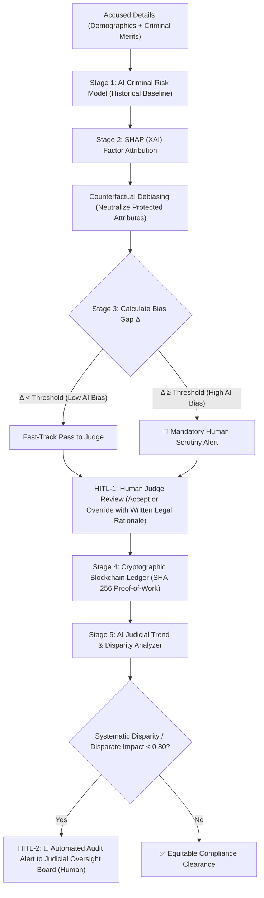

# AI Bias Mitigation in Legal Systems: A Dual-Level Human-in-the-Loop & Blockchain Architecture

An end-to-end prototype designed to prevent algorithmic and human bias in criminal justice risk assessments, ensure judicial transparency through immutable blockchain records, and hold both AI models and human judges accountable.

---

## 🏛️ System Architecture & Workflow

The framework operates in **6 sequential stages** featuring **two independent Human-in-the-Loop (HITL) checkpoints**:



---

## 🔑 Key Components & Implementation

### 1. AI Criminal Risk Scoring (`model.py`)
- Emulates real-world recidivism models (e.g., COMPAS) trained on historical court datasets.
- Distinguishes between:
  - **Legitimate Legal Merits:** Prior felonies, misdemeanors, offense severity (1-10), age at arrest, bail flight history, and community ties.
  - **Protected Demographic Attributes:** Race/caste, income bracket, and gender.
- Unmitigated historical models harbor implicit societal bias, artificially elevating risk scores for marginalized and economically disadvantaged defendants.

### 2. SHAP (XAI) & Counterfactual Debiasing (`xai_shap.py`)
- **Shapley Value Attribution:** Calculates the exact marginal point contribution of each feature $\phi_i$ relative to the neutral population baseline.
- **Factor Isolation:** Explicitly separates legal criminal merits from protected demographic attributes.
- **Counterfactual Intervention:** Constructs a counterfactual profile where sensitive factors (race/caste, income, gender) are set to neutral baseline levels while holding the accused's criminal record constant.
- **Debiased Score & Verdict:** Re-evaluates model on the counterfactual profile to generate an equitable AI recommendation.

### 3. Bias Gap & Level-1 Human-in-the-Loop Judge Review (`legal_system.py`)
- **Bias Gap Metric ($\Delta$):**
  $$\Delta = |S_{\text{original}} - S_{\text{debiased}}|$$
- **Triage Protocols:**
  - **$\Delta < 10.0$ (Low Bias Pass):** Eligible for judicial fast-tracking with standard review.
  - **$\Delta \ge 10.0$ (High Bias Alert):** High demographic bias warning. Mandatory in-depth human review.
- **Judge's Prerogative:** The presiding human judge can **Accept** the debiased recommendation or **Override** it.
- **Due Process Requirement:** The judge *must* submit substantive written judicial reasoning explaining their rationale, preventing unexamined rubber-stamping.

### 4. Cryptographic Blockchain Ledger (`blockchain.py`)
- Immutable SHA-256 proof-of-work blockchain ledger recording:
  - Case ID, anonymized accused profile, legal merits.
  - Raw AI risk score, debiased score, bias gap, and SHAP attribution summary.
  - Presiding Judge ID, Judge's decision (Accepted/Overridden), and final verdict.
  - Written judicial legal reasoning, timestamp, block hash, and previous hash link.
- **Anti-Tampering:** Any post-hoc alteration immediately invalidates cryptographic hash links, preventing reputational whitewashing or surreptitious alterations.

### 5 & 6. AI Judicial Trend Analysis & Level-2 Oversight Board (`judicial_monitor.py`)
- **Audit Scope:** Scans all verdicts committed to the blockchain for each judge.
- **Disparate Impact Ratio (DIR / EEOC 80% Rule):**
  $$\text{DIR} = \frac{P(\text{Favorable Disposition} \mid \text{Marginalized})}{P(\text{Favorable Disposition} \mid \text{General})}$$
- **Discretionary Override Auditing:** Tracks whether a judge selectively overrides AI leniency to penalize marginalized groups or overrides AI severity to favor affluent defendants.
- **Judicial Oversight Board (Human):** Automatically compiles audit dossiers with Fisher exact / $\chi^2$ statistical tests and alerts the board when judges exhibit systematic bias.

---

## 🚀 Quickstart & Usage

### 1. Run the End-to-End CLI Walkthrough
Executes all 6 pipeline stages in terminal mode with full outputs:
```bash
python3 run_cli_demo.py
```

### 2. Launch the Interactive Web Dashboard
Run the Streamlit application for interactive graphical exploration:
```bash
streamlit run app.py
```
*Accessible locally at: `http://localhost:8501`*

The web interface includes:
1. **Accused Assessment & SHAP Debiasing:** Interactive parameter tuning, real-time SHAP waterfall charts, and counterfactual scoring.
2. **Judicial Bench (HITL-1):** Live judicial adjudication form with override options and mandatory reasoning logging.
3. **Blockchain Ledger Explorer:** Full block inspector with live cryptographic tamper detection demonstration.
4. **Judicial Oversight Board (HITL-2):** Disparity metrics, Four-Fifths compliance audits, and judicial bias dossiers.

### 3. Run Automated Unit Tests
```bash
python3 test_pipeline.py
```

---

## 📂 File Directory

| File | Purpose |
| :--- | :--- |
| `model.py` | Baseline AI risk scoring model with historical societal bias weights |
| `xai_shap.py` | SHAP feature attribution calculator and counterfactual debiasing engine |
| `blockchain.py` | SHA-256 cryptographic immutable ledger for judicial verdicts and reasoning |
| `judicial_monitor.py` | AI judicial trend analyzer computing Disparate Impact and board alerts |
| `legal_system.py` | Central coordinator orchestrating the 2-level HITL pipeline |
| `demo_cases.py` | Benchmark cases (High vs Low AI bias) and historical judicial seeding data |
| `app.py` | Complete Streamlit web application with all 4 interactive views |
| `run_cli_demo.py` | End-to-end command-line execution demo |
| `test_pipeline.py` | Unit tests verifying mathematical bounds, XAI, blockchain, and auditing |
